# Ascend Properties

[](https://github.com/Hikki-dev/ascendproperties-lk/actions/workflows/checks.yml)
[](https://ascendproperties-lk.makkoacknowledgesstress.workers.dev)
[](LICENSE)


A website for selling land, houses and apartments in Sri Lanka. It comes with a simple admin that staff can use without touching code, and a private page where customers follow what they have bought.

<p align="center">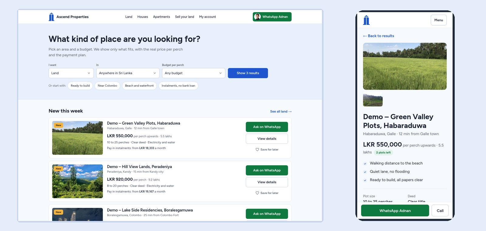</p>

<p align="center"><sub>The site on a desktop and on a phone. <b><a href="https://ascendproperties-lk.makkoacknowledgesstress.workers.dev">Open the live site</a></b> and follow along. The listings are samples. The photos are real ones from Wikimedia Commons, credited in <a href="docs/Photo%20credits.md">Photo credits</a>.</sub></p>

A buyer picks a place and a budget, and sees the real price per perch and the payment plan. Staff add listings from their phone. A customer signs in and sees their balance, receipts and documents.

You do not need to know how any of it works. The screens use plain words and big buttons, and nearly every action ends in WhatsApp, which is how people here already talk to an agent.

## On this page

* [What you get](#what-you-get): who it is for, and what it is built with
* [How everything fits together](#how-everything-fits-together)
* [Try it first](#try-it-first)
* [The story, step by step](#the-story-step-by-step)
  * [Part 1: The buyer](#part-1-the-buyer): [1. Home](#1-home), [2. Find a place](#2-find-a-place), [3. Open a listing](#3-open-a-listing), [4. The details](#4-the-details), [5. What it would cost](#5-what-it-would-cost), [6. Ask, call or visit](#6-ask-call-or-visit), [7. The flyer](#7-the-flyer), [8. On a phone](#8-on-a-phone), [9. Sell your land](#9-sell-your-land)
  * [Part 2: The staff](#part-2-the-staff): [10. Sign in](#10-sign-in), [11. Today](#11-today), [12. Listings](#12-listings), [13. Add or edit a listing](#13-add-or-edit-a-listing), [14. Add from WhatsApp](#14-add-from-whatsapp), [15. Inquiries](#15-inquiries), [16. Sellers](#16-sellers), [17. Banners and ads](#17-banners-and-ads), [18. Contact and advisor](#18-contact-and-advisor), [19. My password](#19-my-password)
  * [Part 3: The customer](#part-3-the-customer): [20. Customers and purchases](#20-customers-and-purchases), [21. One customer](#21-one-customer), [22. The customer portal](#22-the-customer-portal), [23. Support tickets](#23-support-tickets)
* [Run it yourself](#run-it-yourself)
* [Put it online](#put-it-online)
* [Your privacy and safety](#your-privacy-and-safety)
* [Help and more reading](#help-and-more-reading)
* [Legal and responsibility](#legal-and-responsibility)

## What you get

One site, three kinds of people. Each sees only what they need.

| Who | What they do |
|---|---|
| **Buyers** | Search by type, place and budget, see the price per perch, in lakhs and as a monthly instalment, look at photos and plots, work out a payment plan, and ask on WhatsApp or call, with the listing name already in the message |
| **Staff** | Add, edit, hide or mark a listing sold, from a phone. Paste a WhatsApp post, or a whole exported chat, and get hidden draft listings back. Answer enquiries, run banners and ads, and look after customers |
| **Customers** | Sign in to see their purchases, payments, receipts, documents, the handover stage and the next instalment, and open support tickets |

It also has a form for owners who want to sell their land, a printable flyer for each listing, and sharing on WhatsApp. It is modelled on how primelands.lk works, and [the research](docs/PRIMELANDS-RESEARCH.md) shows the evidence.

### What it is built with

| Tool | What it does here |
|---|---|
| **Astro** | Draws the pages on the server, so they load fast and show up in search |
| **React** | Only for the few interactive parts: the photo uploader, the plots table, the payment calculator and the chat importer |
| **Cloudflare Workers** | Runs the whole site, with no separate server |
| **Cloudflare D1** | The database (SQLite): listings, enquiries, customers, payments |
| **Cloudflare R2** | Stores photos, brochures, receipts and documents |

All of it has a free tier that is enough for a growing agency.

## How everything fits together

There is one app and no separate API server. Buyers, customers and staff all use the same Worker. It keeps data in D1, files in R2, and sends people to WhatsApp with links.

<p align="center"><a href="docs/images/how-it-fits.svg">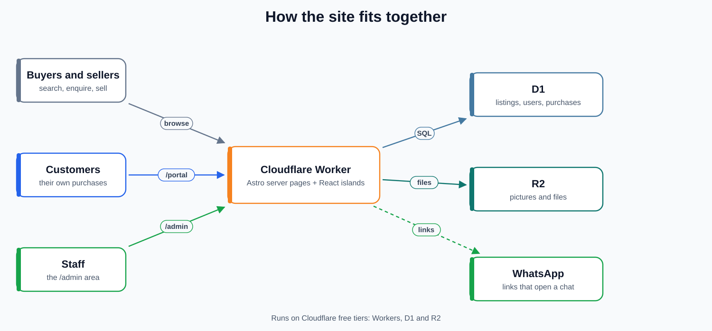</a></p>

After a sale, the customer's journey looks like this:

<p align="center"><a href="docs/images/after-sales.svg">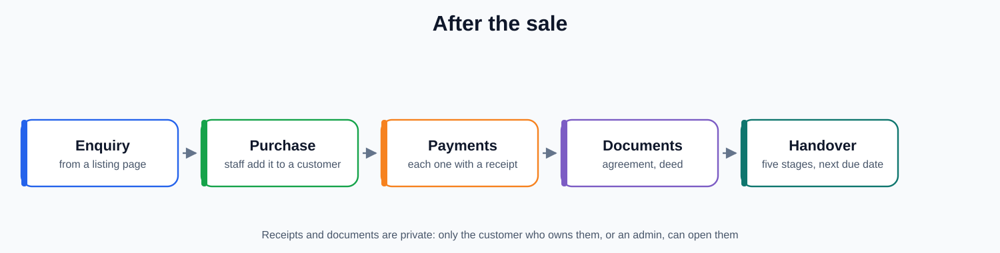</a></p>

The longer story is in [How it works](docs/How%20it%20works.md).

## Try it first

**[Open the live site](https://ascendproperties-lk.makkoacknowledgesstress.workers.dev).** It is the public site running on Cloudflare with four listings. The listings are made up, and the photos are real ones credited in [Photo credits](docs/Photo%20credits.md).

* Browse the listings, filter them, open one and try the buttons. The WhatsApp and call buttons open your phone's apps.
* The admin (`/admin`) and the customer portal (`/portal`) need a login, so they are not open to visitors. The story below shows every screen of them.
* Do not put anything private in the forms. This is a portfolio project.

## The story, step by step

Every picture below was taken from a copy of the site running on a computer, filled with the sample data in `sample-data/` (see [Run it yourself](#run-it-yourself)), at twice the normal sharpness. The live site looks the same but has fewer listings. The names in the pictures, such as Nimali Perera, are made up. Click a picture to see it full size. The same walk, with fewer words, is in [Getting started](docs/Getting%20started.md).

### Part 1: The buyer

It starts with someone who wants to buy a plot near Galle.

#### 1. Home

<a href="docs/images/buyer-home.jpg">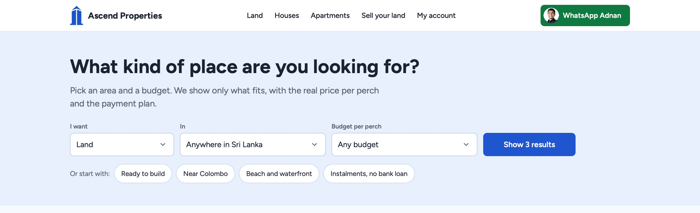</a>

The home page asks one question: *what kind of place are you looking for?* Choose what you want (land, a house or an apartment), where, and your budget per perch, then press **Show results**. The button already says how many results there are. Or tap a shortcut: **Ready to build**, **Near Colombo**, **Beach and waterfront** or **Instalments, no bank loan**.

<a href="docs/images/buyer-new.jpg">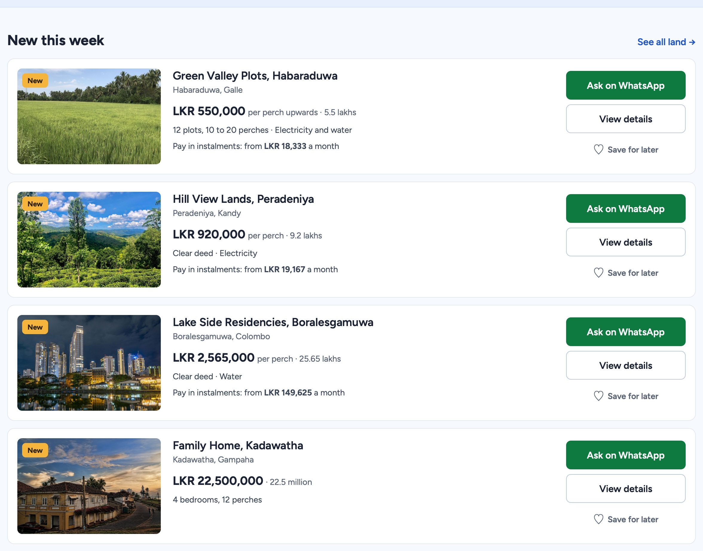</a>

Under the search, **New this week** lists the newest listings. Each card has a photo, the place, the price, the key facts and the monthly instalment, with **Ask on WhatsApp** and **View details**. **Save for later** keeps a listing for the visitor.

<a href="docs/images/buyer-advisor.jpg">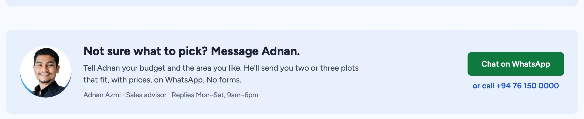</a>

For people who do not want to search, a card offers to message the advisor on WhatsApp: tell them your budget and the area, and they send two or three plots that fit. The advisor's name, photo and hours come from the admin ([step 18](#18-contact-and-advisor)).

<a href="docs/images/buyer-how.jpg">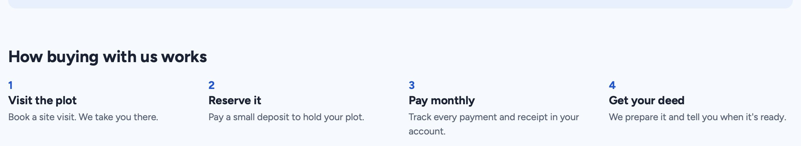</a>

The last part of the home page explains the four steps of buying in plain words: visit the plot, reserve it with a small deposit, pay monthly, and get your deed.

#### 2. Find a place

<a href="docs/images/buyer-lands.jpg">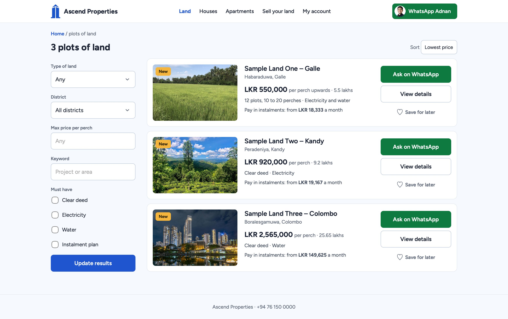</a>

The results show the price per perch, the same price in lakhs, and the monthly instalment, so a buyer can compare plots without a calculator. The filters are the things people really ask about: the type of land, the district, a maximum price per perch, a keyword, and **must have** boxes for a clear deed, electricity, water and an instalment plan. Results can be sorted by lowest price.

<a href="docs/images/buyer-houses.jpg">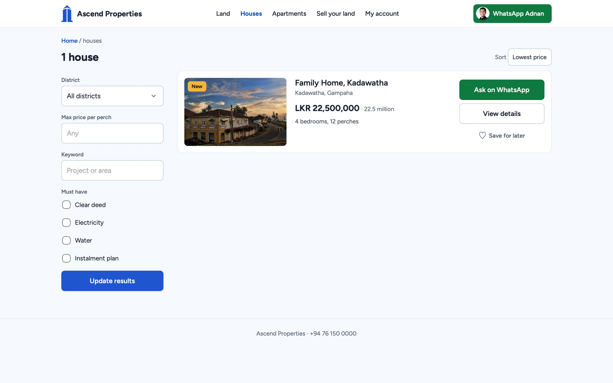</a>

Houses and apartments work the same way. A house card shows the bedrooms and the plot size, and the total price, here **LKR 22,500,000**.

<a href="docs/images/buyer-apartments.jpg">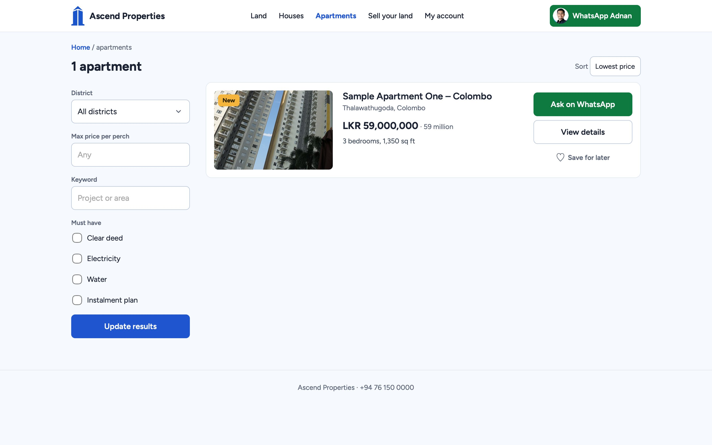</a>

An apartment card shows the bedrooms and the floor size, for example **3 bedrooms, 1,350 sq ft**.

#### 3. Open a listing

<a href="docs/images/buyer-listing.jpg">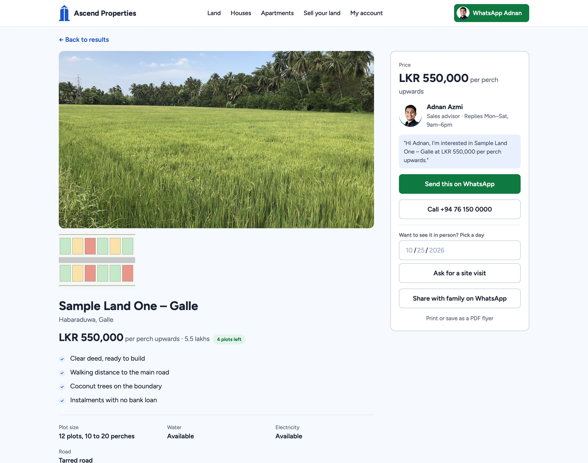</a>

A listing opens with its photos, the price, short highlights and the key facts: the plot size, water, electricity and the road. The second thumbnail here is a drawn plot plan, not a photo. On the right, the advisor card has the advisor's name and reply hours, and a message that is already written for you, with the listing and its price in it.

#### 4. The details

<a href="docs/images/buyer-about.jpg"></a>

**About this land** is a few simple sentences from the agency.

<a href="docs/images/buyer-plots.jpg">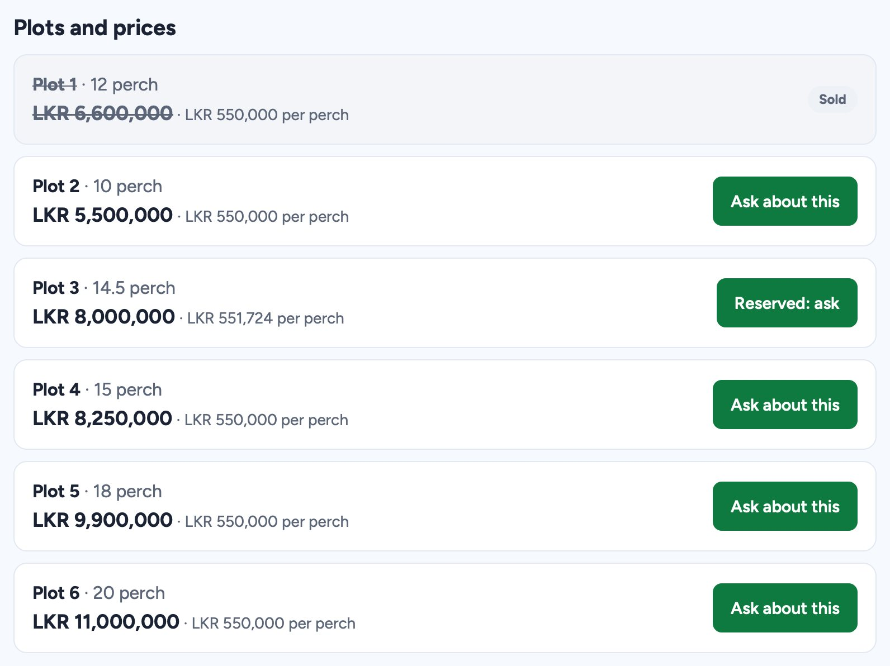</a>

A listing can have a table of numbered plots. Each has its size in perches, its price, and a status. A **sold** plot is crossed out. A **reserved** one says **Reserved: ask**. An available one has **Ask about this**, which opens WhatsApp about that plot.

<a href="docs/images/buyer-nearby.jpg">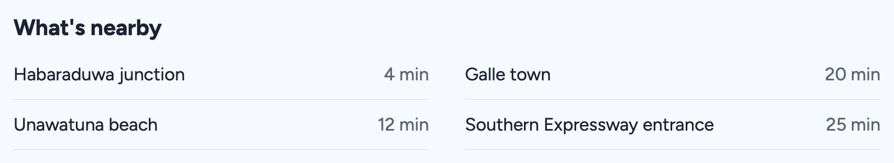</a>

**What's nearby** lists the places a buyer cares about and how far they are, such as the junction, the town and the beach.

#### 5. What it would cost

<a href="docs/images/buyer-pay.jpg">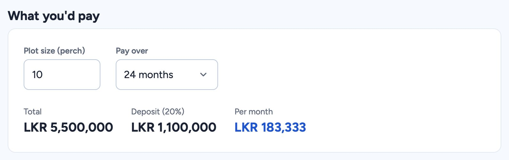</a>

This small calculator answers the question buyers ask first. Type the size of the plot you want and the number of months, and it shows the **total**, the **deposit** and the amount **per month**. The deposit and the number of months it starts with are set by staff for each listing ([step 13](#13-add-or-edit-a-listing)).

#### 6. Ask, call or visit

The advisor card from step 3 has four things a buyer can do:

* **Send this on WhatsApp** opens WhatsApp with a message that already names the listing and its price.
* **Call** dials the agency.
* **Pick a day**, then **Ask for a site visit**, opens WhatsApp with a message asking to visit on that day.
* **Share with family on WhatsApp** sends the listing to someone else.

<a href="docs/images/buyer-callback.jpg">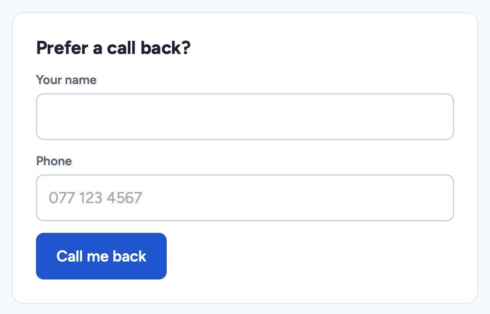</a>

Lower on the page, **Prefer a call back?** takes a name and a phone number. The staff see it under **Inquiries** ([step 15](#15-inquiries)).

<a href="docs/images/buyer-similar.jpg">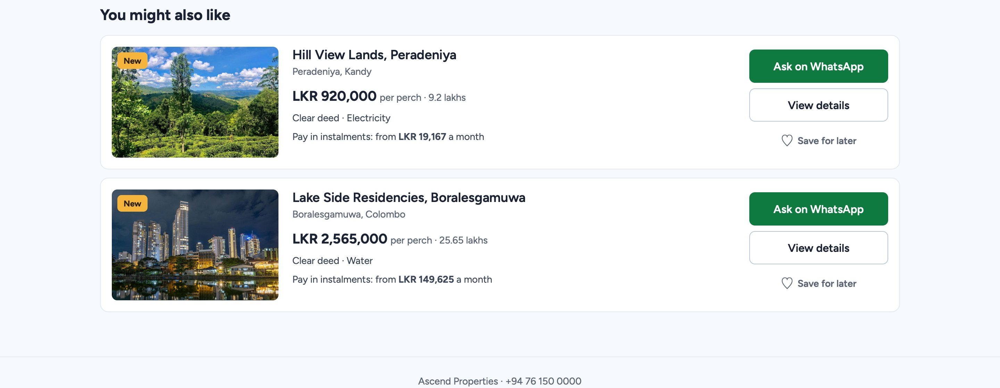</a>

At the bottom, **You might also like** shows more listings, so a buyer who is not sure about this one keeps looking.

#### 7. The flyer

<a href="docs/images/buyer-flyer.jpg">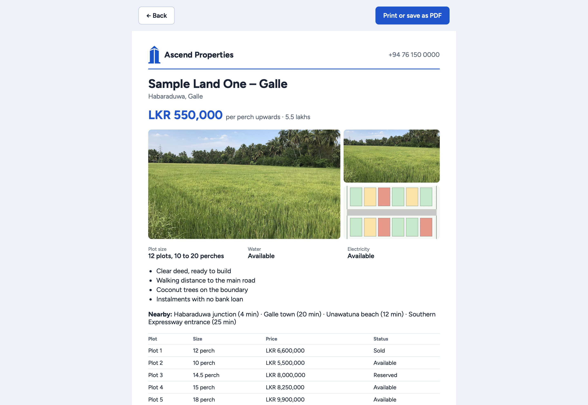</a>

**Print or save as a PDF flyer** opens a clean one-page version of the listing: photos, price, highlights, what is nearby and the plots table. It is made to be printed or sent as a PDF.

#### 8. On a phone

Most buyers will be on a phone. Here is the whole journey on one, left to right. Click a picture to see it full size.

<table>
<tr>
<td valign="top" width="25%"><a href="docs/images/phone-home.jpg">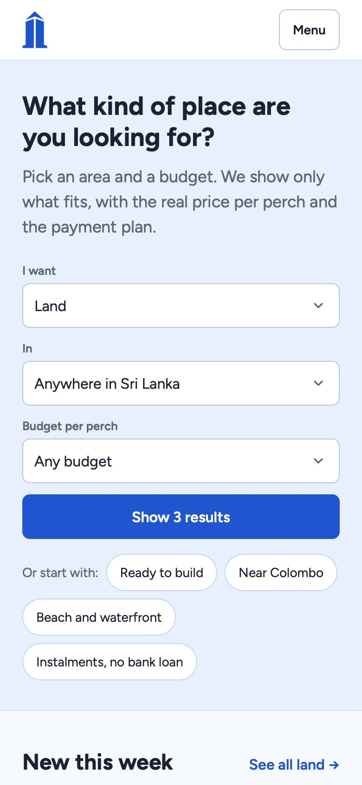</a></td>
<td valign="top" width="25%"><a href="docs/images/phone-lands.jpg">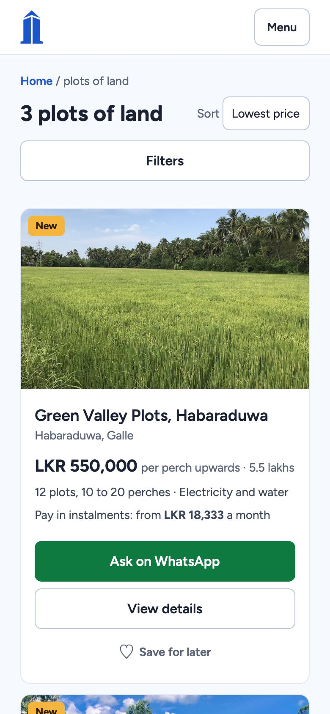</a></td>
<td valign="top" width="25%"><a href="docs/images/phone-listing.jpg">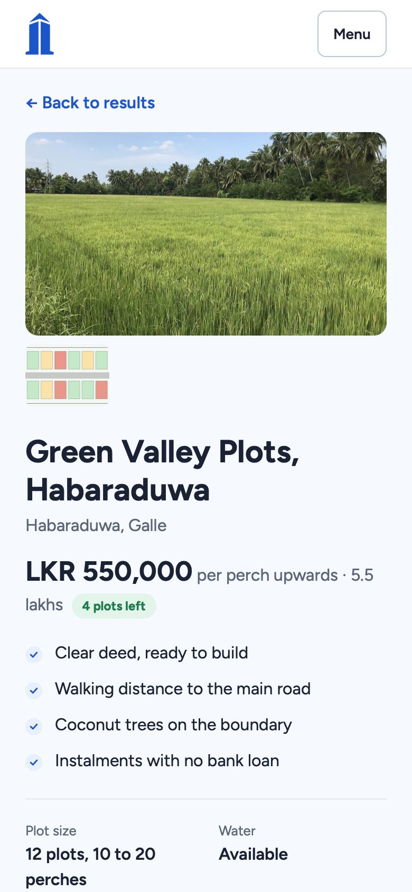</a></td>
<td valign="top" width="25%"><a href="docs/images/phone-listing-2.jpg">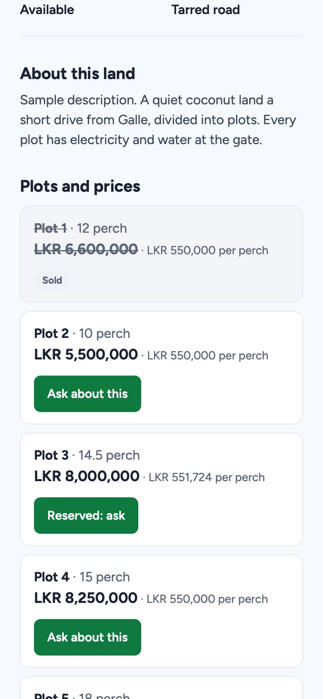</a></td>
</tr>
<tr>
<td align="center" valign="top"><b>1</b><br><sub>Home</sub></td>
<td align="center" valign="top"><b>2</b><br><sub>Results</sub></td>
<td align="center" valign="top"><b>3</b><br><sub>A listing</sub></td>
<td align="center" valign="top"><b>4</b><br><sub>Plots and prices</sub></td>
</tr>
</table>

<table>
<tr>
<td valign="top" width="25%"><a href="docs/images/phone-portal.jpg">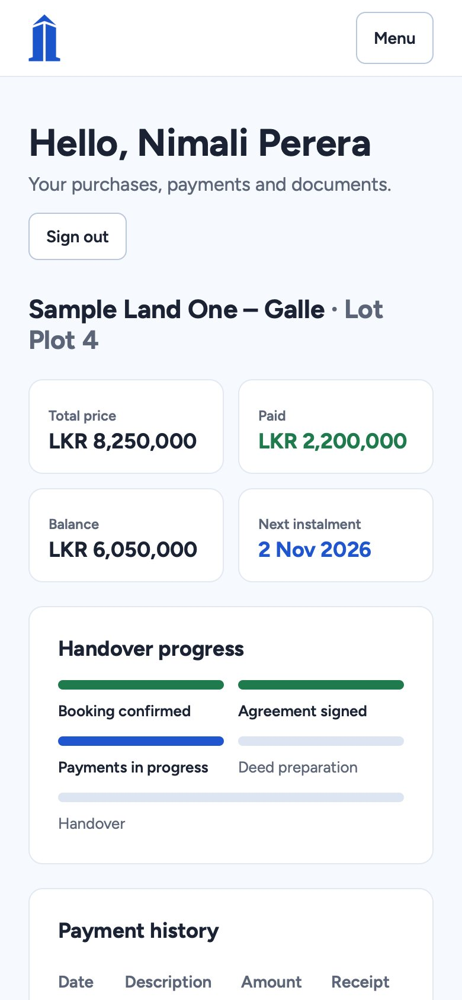</a></td>
<td></td>
<td></td>
<td></td>
</tr>
<tr>
<td align="center" valign="top"><b>5</b><br><sub>Customer portal</sub></td>
<td></td>
<td></td>
<td></td>
</tr>
</table>

**1. Home.** The menu folds into one button, and the search and shortcuts fill the screen. **2. Results.** The filters fold away behind **Filters**, so the listings come first. **3. A listing.** The photo, the price and the highlights, with a **WhatsApp** and **Call** bar that stays at the bottom, so the next step is always one tap away. **4. Plots and prices.** Further down, the plots table with its **Ask about this** buttons. **5. Customer portal.** A customer sees the same numbers on a phone as on a desktop ([step 22](#22-the-customer-portal)).

#### 9. Sell your land

<a href="docs/images/buyer-sell.jpg">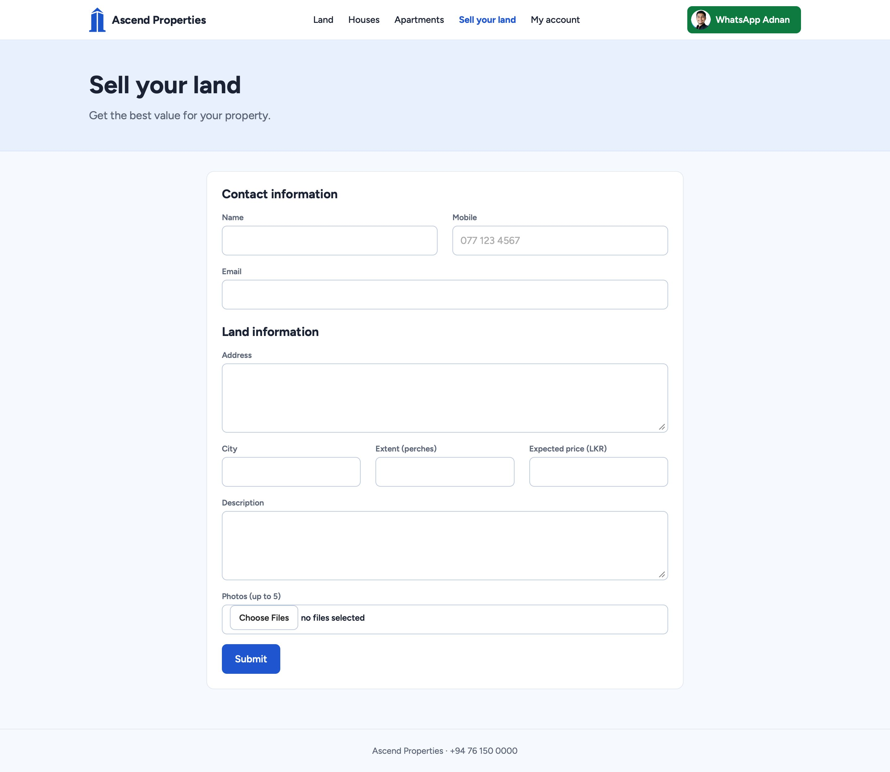</a>

Owners can send their land to the agency. They give their name, mobile and email, then the address, town, size in perches, expected price and a description, and add up to five photos. The staff see it under **Sellers** ([step 16](#16-sellers)).

<a href="docs/images/buyer-contact.jpg">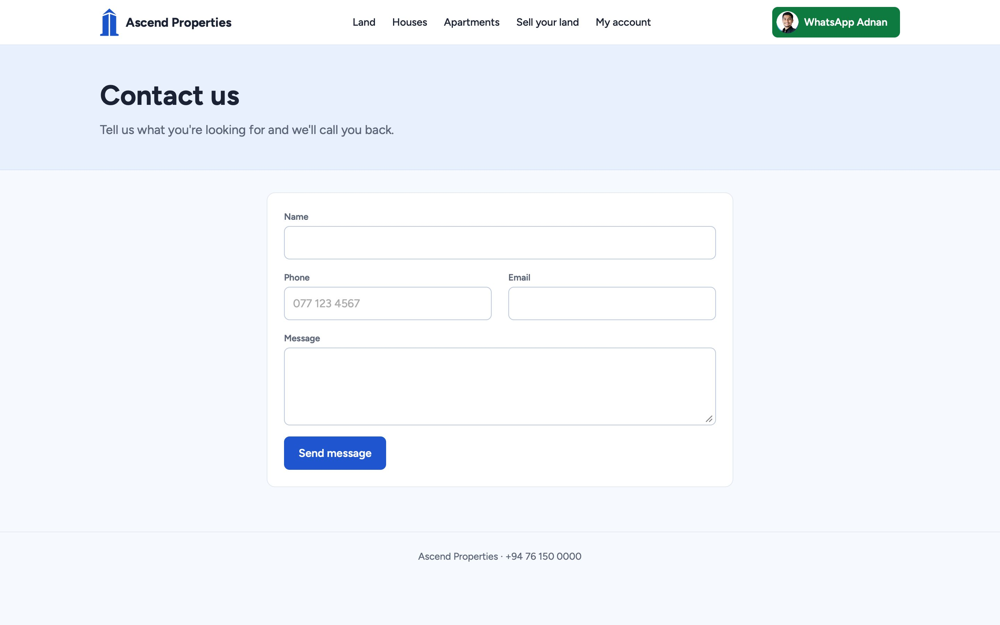</a>

The **Contact** page is a short form (name, phone, email and a message) for everything else. It arrives under **Inquiries**, the same as a call-back request.

That is the buyer's whole journey. Now the people behind the screen.

### Part 2: The staff

The staff have no code to touch. They sign in and see their own pages. Everything below is in plain words, on purpose.

#### 10. Sign in

<a href="docs/images/sign-in.jpg">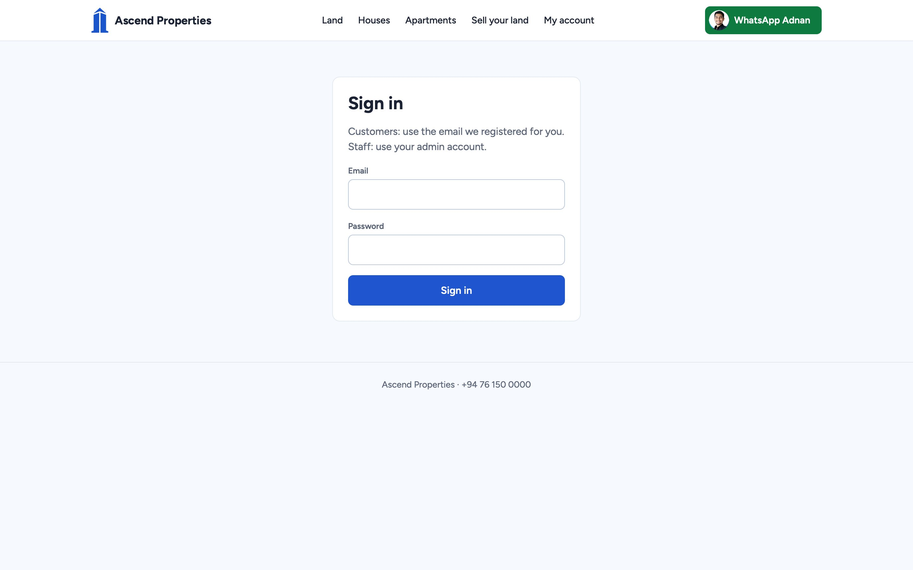</a>

Staff and customers use the same sign-in page. An admin is sent to the admin, and a customer to their portal. Sessions last 14 days.

#### 11. Today

<a href="docs/images/admin-today.jpg">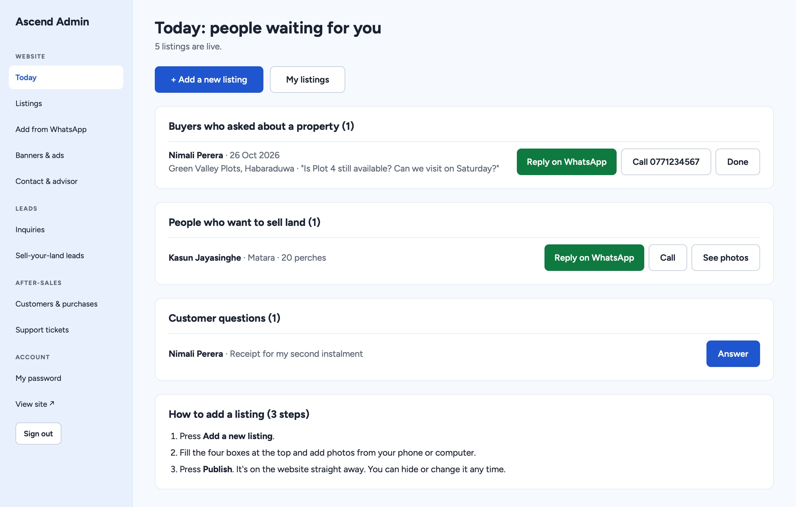</a>

The admin opens on **Today**: who has asked about a property, who wants to sell, and which customers have an open support question. Buyers and sellers have **Reply on WhatsApp** and **Call** buttons, and **Done** when it has been dealt with. A customer question has an **Answer** button. At the bottom, three short steps remind staff how to add a listing. The menu on the left groups everything into **Website**, **Leads**, **After-sales** and **Account**.

#### 12. Listings

<a href="docs/images/admin-listings.jpg">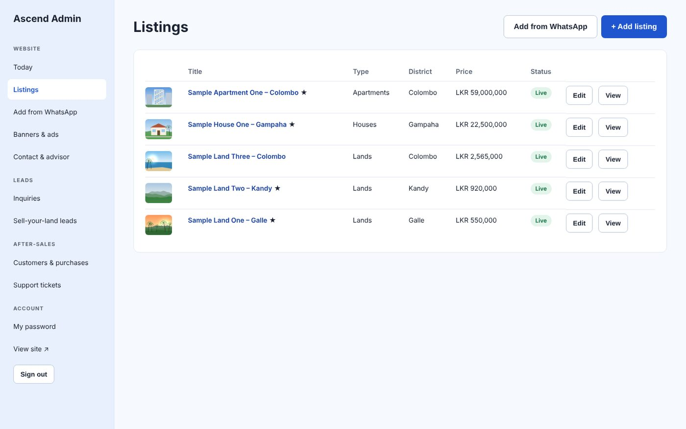</a>

All the listings in one table, with a photo, the type, the district, the price, and whether each is **Live**. A star marks the featured ones. **Edit** opens a listing, **View** shows it on the website, **Add from WhatsApp** and **Add listing** are at the top.

#### 13. Add or edit a listing

A listing is one page with numbered boxes, from the most important to the least. Staff fill in as much as they like. It is on the website as soon as they save.

<a href="docs/images/admin-edit-1-basics.jpg">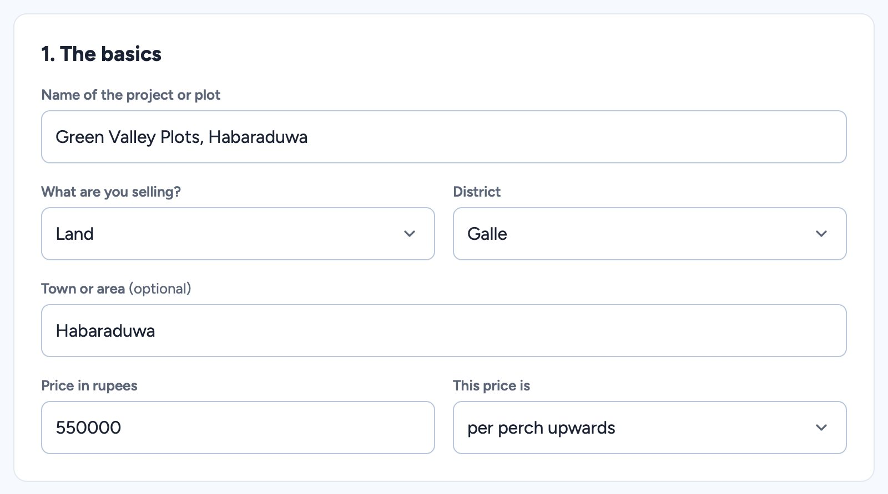</a>

**1. The basics.** The name, what is being sold, the district, the town, the price, and how the price is counted (here, per perch upwards).

<a href="docs/images/admin-edit-2-photos.jpg">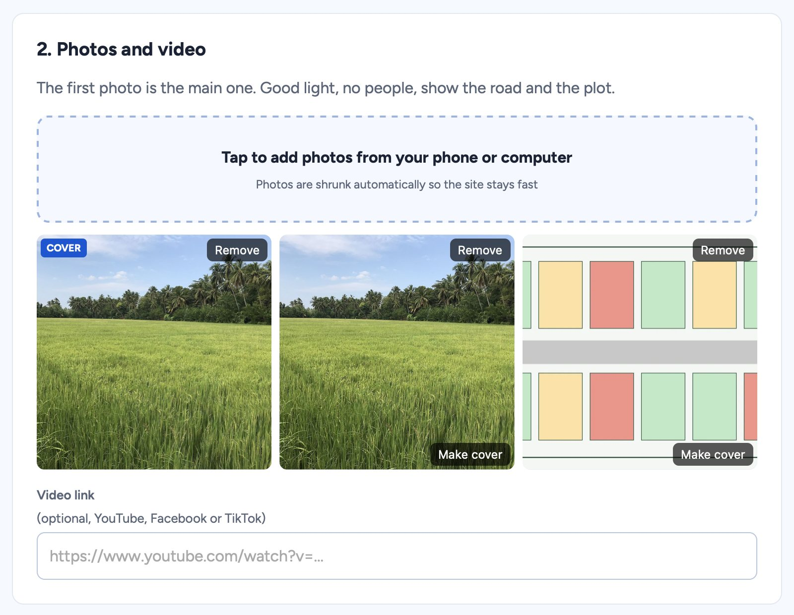</a>

**2. Photos and video.** Tap the box and choose photos from the phone or the computer. They are made smaller before they are uploaded, so the site stays fast. The first photo is the cover, and **Make cover** changes it. A video link is optional (YouTube, Facebook or TikTok).

<a href="docs/images/admin-edit-3-tell.jpg">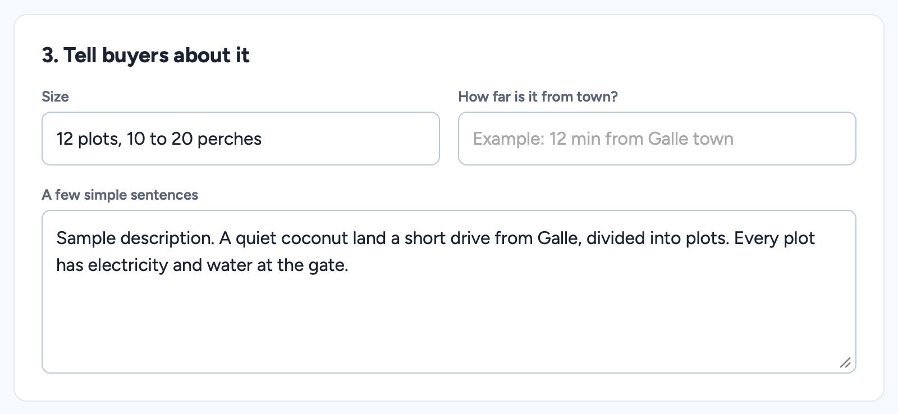</a>

**3. Tell buyers about it.** The size, how far it is from town, and a few simple sentences.

<a href="docs/images/admin-edit-4-special.jpg">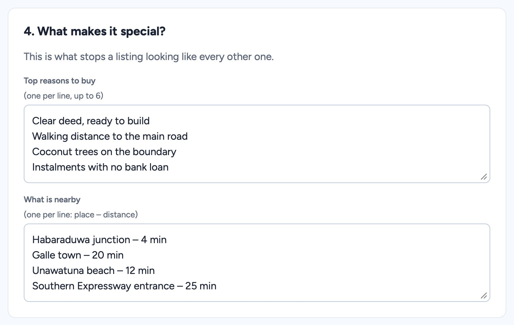</a>

**4. What makes it special?** The top reasons to buy, one per line, and what is nearby, one per line, with the distance. These become the highlights and the **What's nearby** list in steps 3 and 4.

<a href="docs/images/admin-edit-5-comes.jpg">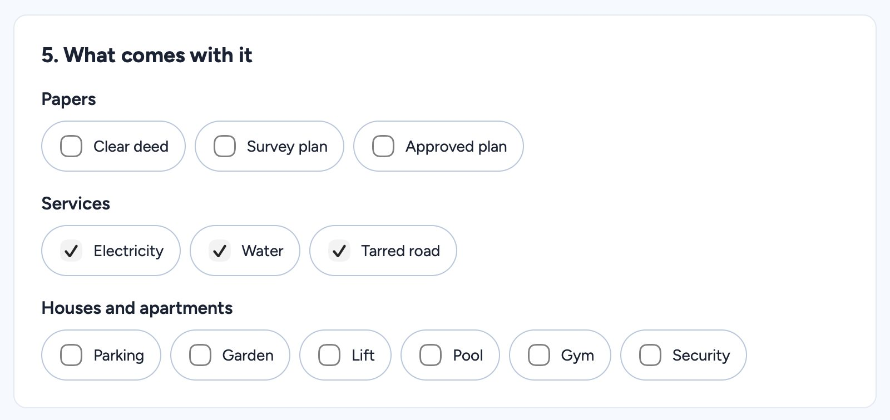</a>

**5. What comes with it.** Tick boxes for the papers (clear deed, survey plan, approved plan), the services (electricity, water, tarred road) and, for houses and apartments, things like parking, a garden, a lift, a pool, a gym and security. These feed the **must have** filters in step 2.

<a href="docs/images/admin-edit-6-plots.jpg">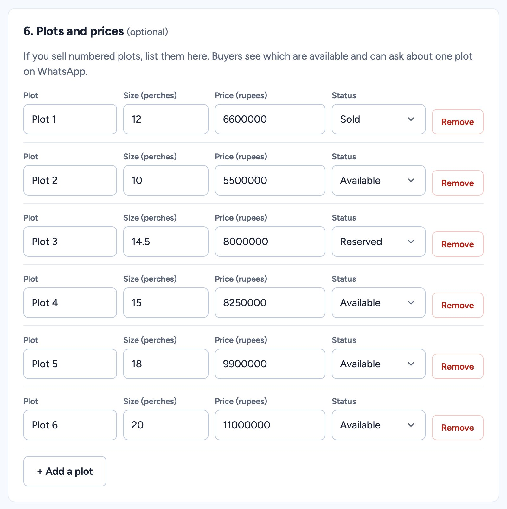</a>

**6. Plots and prices.** One row for each numbered plot: its name, size in perches, price and status (available, reserved or sold). **+ Add a plot** adds a row.

<a href="docs/images/admin-edit-7-plan.jpg">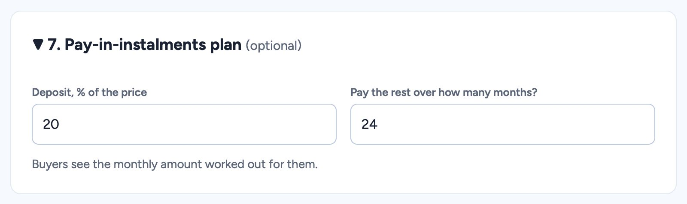</a>

**7. Pay-in-instalments plan.** The deposit as a percentage of the price, and the number of months to pay the rest. Buyers see the monthly amount worked out for them, here and in the calculator in step 5.

<a href="docs/images/admin-edit-8-more.jpg">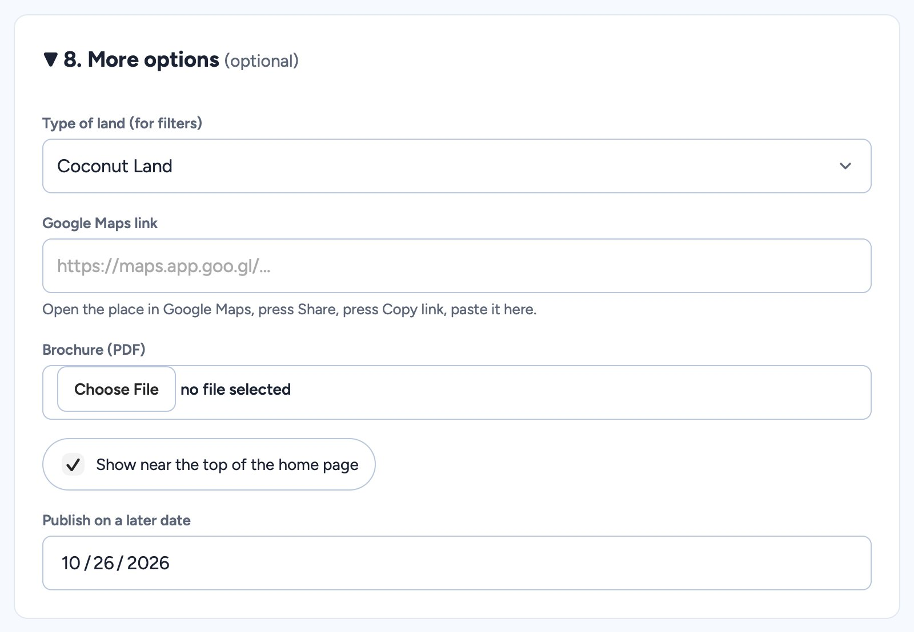</a>

**8. More options.** The type of land (it feeds the filter), a Google Maps link, a brochure (PDF), whether to show the listing near the top of the home page, and a publish date.

<p align="center"><a href="docs/images/admin-edit-visible.jpg">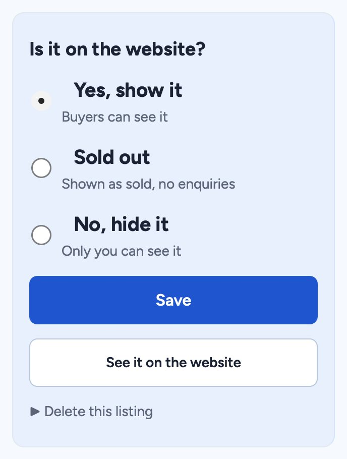</a></p>

Beside the form, **Is it on the website?** is a simple choice: **Yes, show it**, **Sold out** (shown as sold, with no enquiries) or **No, hide it** (only staff can see it). **Save** publishes the change, and **See it on the website** opens the page. A listing can be deleted from the same box.

#### 14. Add from WhatsApp

<a href="docs/images/admin-import.jpg">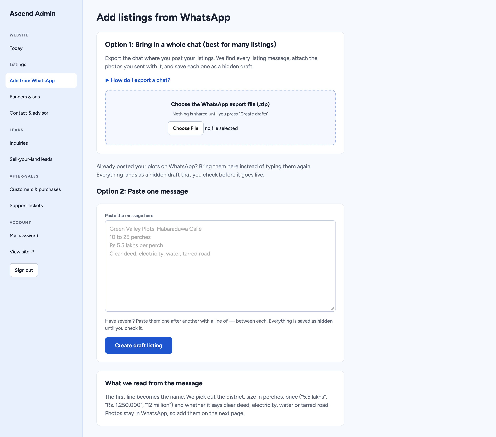</a>

This is the time-saver. **Option 1** takes a whole exported WhatsApp chat (the `.zip` file, with media): each listing it finds becomes a **hidden draft** with its photos. **Option 2** takes one pasted message. The district, the size in perches, the price and the papers are read from the text. Staff check each draft, fix what is wrong and publish it. Nothing goes live until they say so.

<a href="docs/images/admin-import-open.jpg">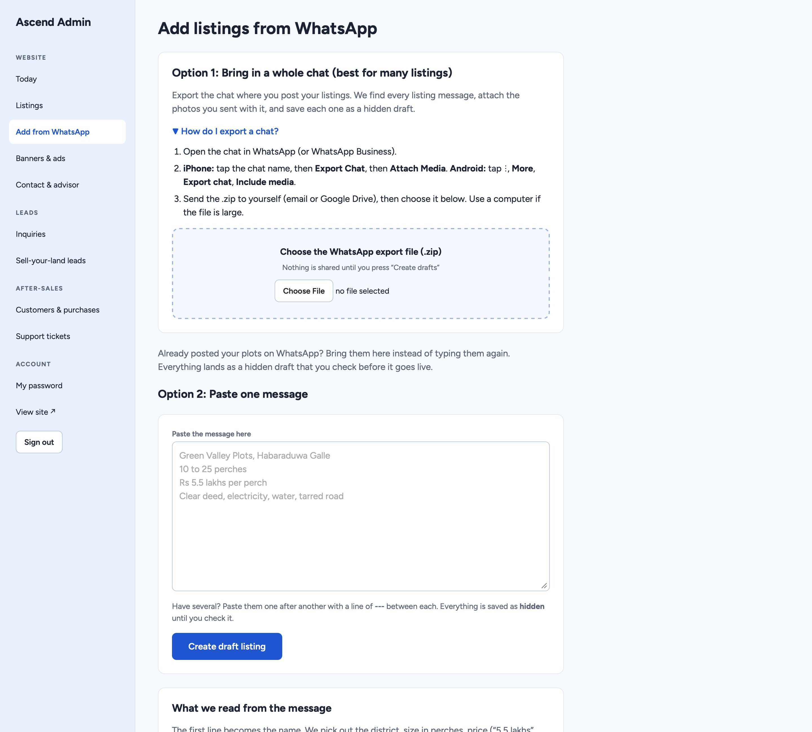</a>

A short guide on the page, **How do I export a chat?**, explains how to make the file.

#### 15. Inquiries

<a href="docs/images/admin-inquiries.jpg">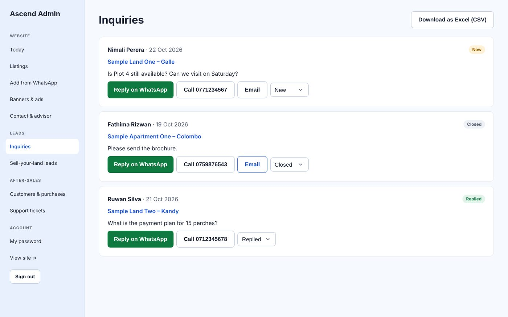</a>

Questions from the website arrive here, each with the listing it was about. Reply on WhatsApp, call or email, and set the status, for example **New**, **Replied** or **Closed**. **Download as Excel (CSV)** saves them all.

#### 16. Sellers

<a href="docs/images/admin-sellers.jpg">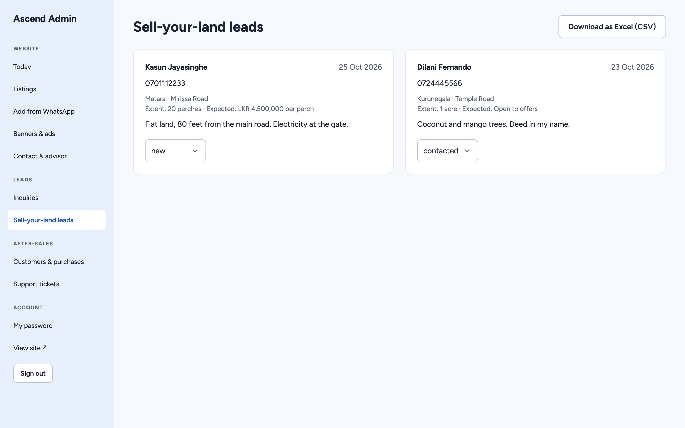</a>

The owners who filled in the form in step 9 appear here, with their phone, the place, the size, the price they hope for and their description. Their photos are for admins only. Each lead has a status, such as **new** or **contacted**.

#### 17. Banners and ads

<a href="docs/images/admin-banners.jpg">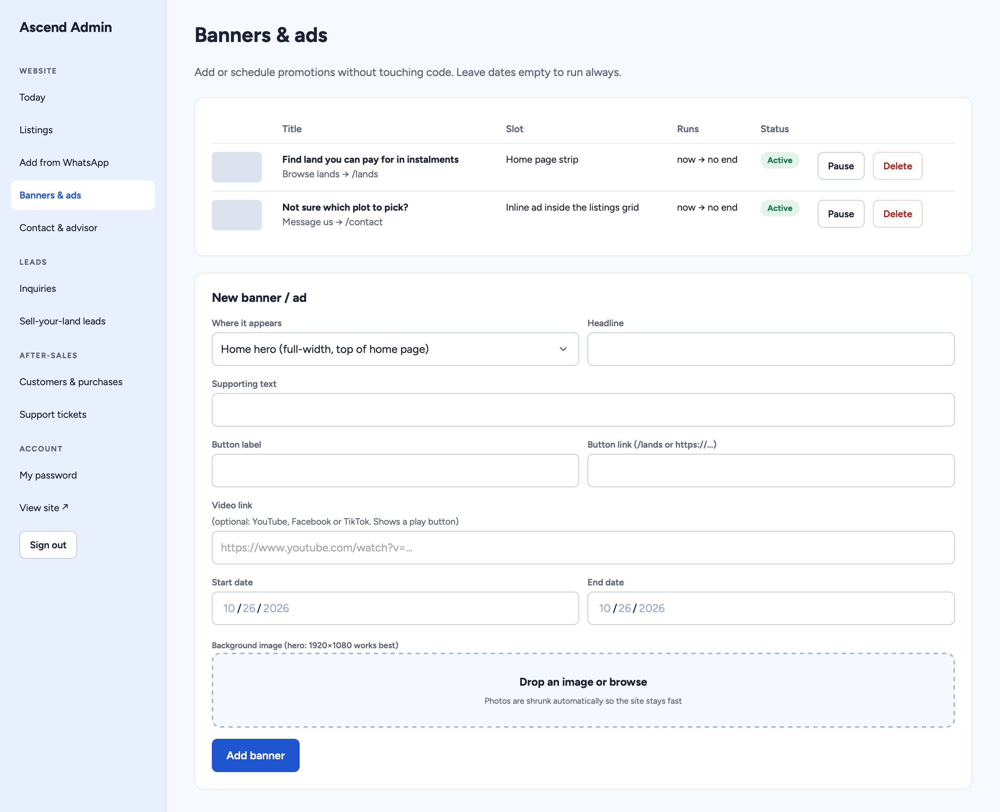</a>

A banner can sit on the home page, as the hero or a strip, or as a sponsored slot between the listings. Each has a headline, some text, a button, an optional video or image, and start and end dates. Leave the dates empty to run it always. **Pause** hides one without deleting it.

#### 18. Contact and advisor

<a href="docs/images/admin-settings.jpg">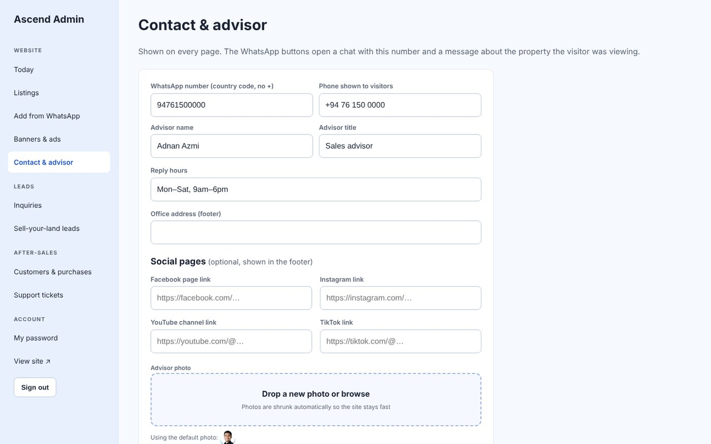</a>

The WhatsApp number every button uses, the phone number shown to visitors, the advisor's name, title and reply hours, the office address, the social pages and the advisor's photo. A change shows on every page at once.

#### 19. My password

<a href="docs/images/admin-account.jpg">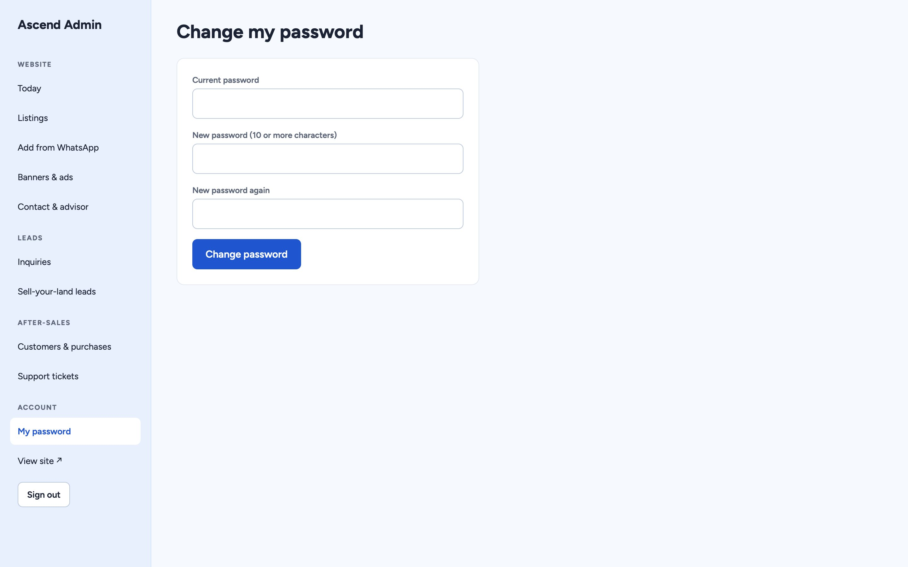</a>

Staff can change their own password here. Use a long one you do not use anywhere else.

The staff's work is finished once a buyer says yes. Then the third person in the story arrives.

### Part 3: The customer

After a sale the customer gets a login, and the agency keeps the records.

#### 20. Customers and purchases

<a href="docs/images/admin-customers.jpg">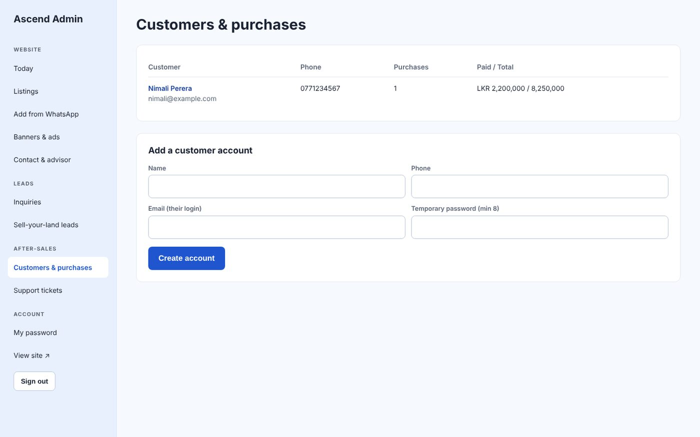</a>

Customers do not register themselves. Staff add a customer with a name, a phone number, an email (it is their login) and a temporary password of at least 8 characters. The table shows each customer's number of purchases and how much has been paid of the total.

#### 21. One customer

<a href="docs/images/admin-customer.jpg">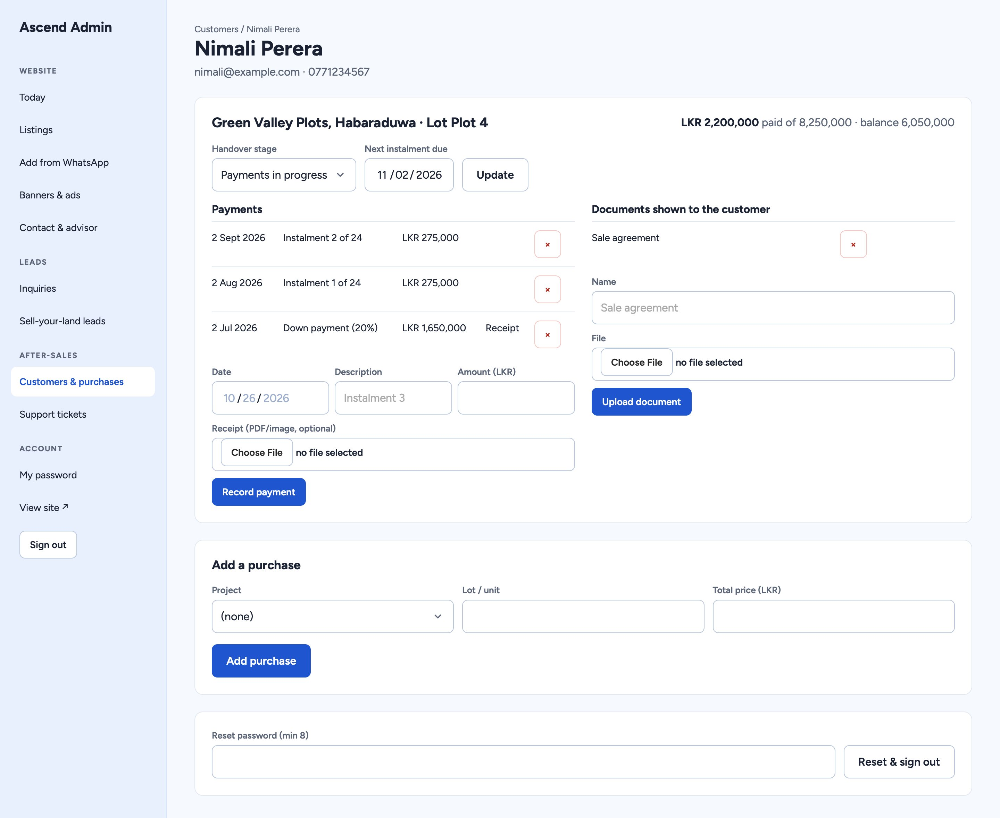</a>

For each customer, staff add the purchase (the project, the plot and the total price) and then keep it up to date: record each **payment** with its date, description, amount and a receipt, upload **documents** such as the sale agreement, set the **handover stage** and the **next instalment due** date, and reset a forgotten password. The paid amount and the balance are worked out for them.

#### 22. The customer portal

<a href="docs/images/portal-top.jpg">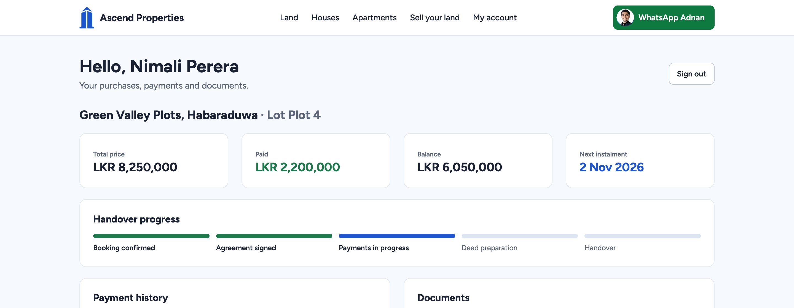</a>

The customer signs in and lands on their portal. They see only their own purchases. At the top are four numbers: the **total price**, what they have **paid**, the **balance** and the **next instalment**. Under them, **Handover progress** shows the five stages: Booking confirmed, Agreement signed, Payments in progress, Deed preparation and Handover.

<a href="docs/images/portal-pay.jpg">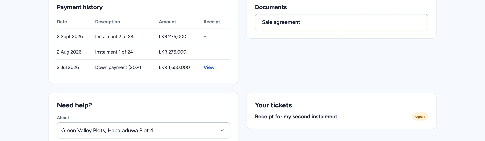</a>

**Payment history** lists every payment with its receipt, where there is one, and **Documents** has the agreement and anything else staff have added. Receipts and documents are private: only their owner and an admin can open them.

#### 23. Support tickets

<a href="docs/images/portal-help.jpg">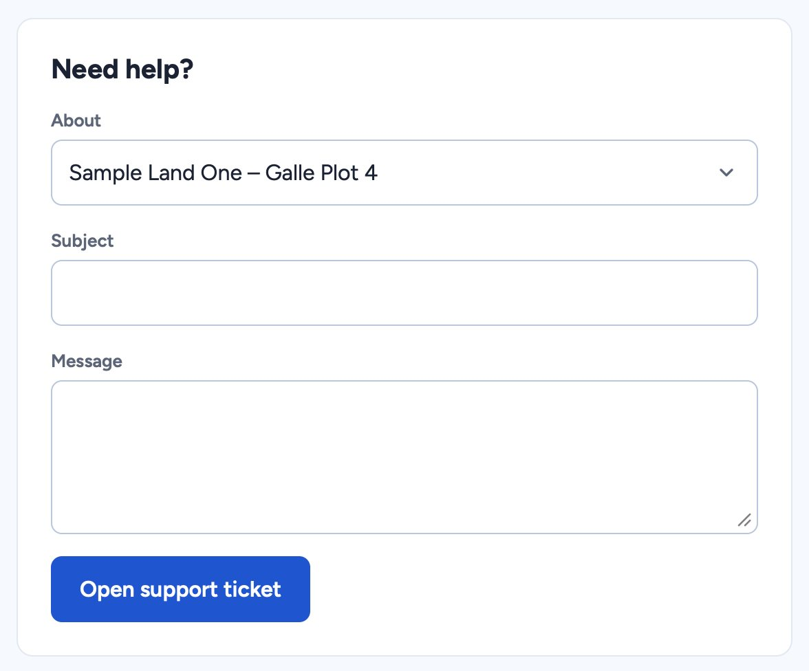</a>

If something is wrong, the customer opens a ticket from **Need help?**: they choose the purchase, write a subject and a message, and press **Open support ticket**. Their tickets are listed beside it.

<a href="docs/images/admin-tickets.jpg">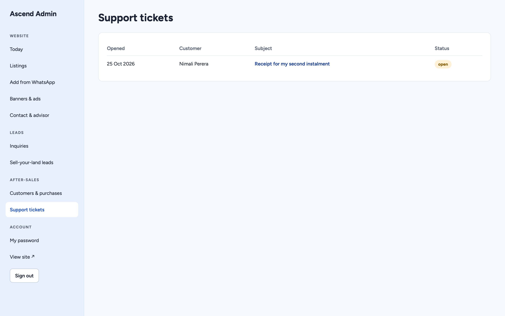</a>

Staff see every ticket in a list, with its status.

<a href="docs/images/admin-ticket.jpg">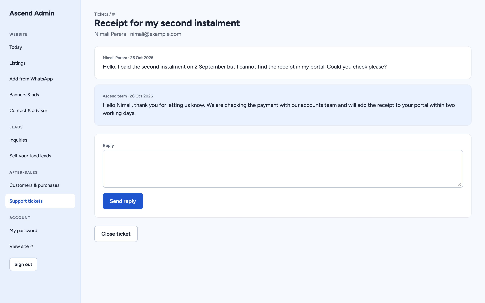</a>

Staff open a ticket, read it, reply and close it when it is solved.

<a href="docs/images/portal-ticket.jpg"></a>

The customer sees the reply in their portal, and can answer from there. More in the [Customer portal](docs/Customer%20portal.md) guide.

The portal works on a phone too (picture 5 in [step 8](#8-on-a-phone)). That closes the loop: the staff's listings are what the buyer searched for in step 2. More in the [Admin guide](docs/Admin%20guide.md).

## Run it yourself

You need Node 22.22 or newer (Astro 7 requires it). There is nothing to set up in the cloud: Wrangler runs a local copy of D1 and R2 for you.

```bash
git clone https://github.com/Hikki-dev/ascendproperties-lk.git
cd ascendproperties-lk
npm install
cp .dev.vars.example .dev.vars     # set ADMIN_EMAIL and ADMIN_PASSWORD
npm run db:local                   # creates the local database and five sample listings
npm run dev                        # http://localhost:4321
```

Sign in at `/login` with the admin email and password from `.dev.vars`. The first admin is created the first time you sign in.

**Want it to look like the pictures above?** With `npm run dev` still running, in a second terminal:

```bash
bash sample-data/load.sh
```

That adds the sample photos, plots, highlights and nearby places, some enquiries and leads, and a customer with a purchase, three payments and a document. Sign in at `/portal` as `nimali@example.com` with the password `sample-customer-1`. Details are in [Sample data](docs/Sample%20data.md). It only touches your local copy.

`npm test` runs the unit tests (12 of them). `tests/smoke.sh` runs a longer end-to-end check against the dev server. Step by step, with fixes for the usual snags, is in [Getting started](docs/Getting%20started.md).

## Put it online

```bash
npx wrangler login
npx wrangler d1 create ascend-db          # paste the database_id into wrangler.jsonc
npx wrangler r2 bucket create ascend-media
npm run db:remote                         # apply migrations
npx wrangler secret put ADMIN_EMAIL
npx wrangler secret put ADMIN_PASSWORD
npm run deploy
```

Then in the Cloudflare dashboard add your domain, turn on **Bot Fight Mode** and a rate-limit rule for `/api/*` and `/login`, and, if you like, put `/admin*` behind **Cloudflare Access** (free for up to 50 users) for a second login. Spam protection with Turnstile is optional. All the steps, including the optional ones, are in [Deploying](docs/Deploying.md).

## Your privacy and safety

* Passwords are hashed with PBKDF2-SHA256 (100,000 rounds, a salt for every user). A session is a random 256-bit token in an `HttpOnly`, `SameSite=Lax` cookie, kept in D1, and it expires after 14 days.
* `/admin/*` needs an admin session and `/portal/*` needs a login. Forms from other websites are refused (Astro's origin check).
* Every SQL query is parameterised. Uploads are checked for type and size. Redirects, map links and video links are checked against exact hostnames.
* Receipts and customer documents are private. They are served only to their owner or an admin. Seller photos are for admins only.
* Public forms have a hidden honeypot field, and Cloudflare Turnstile turns on by itself once its secret exists.
* Security headers are set on every response.

To report a security problem, read [SECURITY.md](SECURITY.md).

## Help and more reading

| If you want to | Read |
|---|---|
| Run it step by step | [Getting started](docs/Getting%20started.md) |
| Use the admin | [Admin guide](docs/Admin%20guide.md) |
| See what customers see | [Customer portal](docs/Customer%20portal.md) |
| Understand how it is built | [How it works](docs/How%20it%20works.md) |
| Put it on Cloudflare | [Deploying](docs/Deploying.md) |
| Fill a local copy with sample data | [Sample data](docs/Sample%20data.md) |
| See who took the sample photos | [Photo credits](docs/Photo%20credits.md) |
| Fix a problem | [Fixing problems](docs/Fixing%20problems.md) |
| Find a quick answer | [Questions and answers](docs/FAQ.md) |
| See why it works like primelands.lk | [Research](docs/PRIMELANDS-RESEARCH.md) |
| Change the code | [Contributing](CONTRIBUTING.md) |
| See what changed | [Changes](CHANGELOG.md) |

### Where things live

```
migrations/      D1 schema            seed.sql   five sample listings (delete before launch)
src/lib/         db, auth, util, parse, chat      src/pages/   public site, /admin, /portal, /api
src/components/  ImageUploader, LoanCalc, LotsEditor, ChatImport (React islands), cards, ads
sample-data/            sample data, sample photos and the script that loads them
tests/           unit tests and an end-to-end smoke script
```

## Legal and responsibility

* Ascend Properties is a portfolio and learning project, not a real agency's site. The listings are made up.
* The code is released under the [MIT licence](LICENSE), as it is, with no promises. The sample photos keep their own licences, see [Photo credits](docs/Photo%20credits.md).
* [primelands.lk](docs/PRIMELANDS-RESEARCH.md) is studied only for how a site like this works. This project is not connected to it.
* Built with [Astro](https://astro.build), [React](https://react.dev) and [Cloudflare Workers](https://workers.cloudflare.com). Zip handling is by [fflate](https://github.com/101arrowz/fflate).
* Built by [Yusuf (Hikki-dev)](https://github.com/Hikki-dev).
