# Ascend Properties

[](https://github.com/Hikki-dev/ascendproperties-lk/actions/workflows/checks.yml)
[](https://ascendproperties-lk.makkoacknowledgesstress.workers.dev)
[](LICENSE)


A website for selling land, houses and apartments in Sri Lanka. It comes with a simple admin that staff can use without touching code, and a private page where customers follow what they have bought.

<p align="center"></p>

<p align="center"><sub>The live demo, on a desktop and on a phone. <b><a href="https://ascendproperties-lk.makkoacknowledgesstress.workers.dev">Open it</a></b> and follow along. The listings are samples, and the photos are real ones from Wikimedia Commons, credited in <a href="docs/Photo%20credits.md">Photo credits</a>.</sub></p>

A buyer picks a place and a budget, and sees the real price per perch and the payment plan. Staff add listings from their phone. A customer signs in and sees their balance, receipts and documents.

You do not need to know how any of it works. The screens use plain words and big buttons, and nearly every action ends in WhatsApp, which is how people here already talk to an agent.

## On this page

* [What you get](#what-you-get): who it is for, and what it is built with
* [How everything fits together](#how-everything-fits-together)
* [Try it first](#try-it-first): the live demo
* [The story, step by step](#the-story-step-by-step)
  * [Part 1: The buyer](#part-1-the-buyer): [1. Home](#1-home), [2. Find land](#2-find-land), [3. Open a listing](#3-open-a-listing), [4. Plots and prices](#4-plots-and-prices), [5. Ask, visit or share](#5-ask-visit-or-share), [6. On a phone](#6-on-a-phone), [7. Houses](#7-houses), [8. Sell your land](#8-sell-your-land)
  * [Part 2: The staff](#part-2-the-staff): [9. Today](#9-today), [10. Listings](#10-listings), [11. Edit a listing](#11-edit-a-listing), [12. Add from WhatsApp](#12-add-from-whatsapp), [13. Inquiries](#13-inquiries), [14. Sellers](#14-sellers), [15. Banners and ads](#15-banners-and-ads), [16. Contact and advisor](#16-contact-and-advisor)
  * [Part 3: The customer](#part-3-the-customer): [17. Customers and purchases](#17-customers-and-purchases), [18. One customer](#18-one-customer), [19. The customer portal](#19-the-customer-portal), [20. Support tickets](#20-support-tickets)
* [Run it yourself](#run-it-yourself)
* [Put it online](#put-it-online)
* [Your privacy and safety](#your-privacy-and-safety)
* [Help and more reading](#help-and-more-reading)
* [Legal and responsibility](#legal-and-responsibility)

## What you get

One site, three kinds of people. Each sees only what they need.

| Who | What they do |
|---|---|
| **Buyers** | Search by type, place and budget, see the price per perch, in lakhs and as a monthly instalment, look at photos and plots, and ask on WhatsApp or call, with the listing name already in the message |
| **Staff** | Add, edit, hide or mark a listing sold, from a phone. Paste a WhatsApp post, or a whole exported chat, and get hidden draft listings back. Answer enquiries, run banners and ads, and look after customers |
| **Customers** | Sign in to see their purchases, payments, receipts, documents, the handover stage and the next instalment, and open support tickets |

It also has a form for owners who want to sell their land, a printable flyer for each listing, sharing on WhatsApp, and a payment calculator on each listing. It is modelled on how primelands.lk works, and [the research](docs/PRIMELANDS-RESEARCH.md) shows the evidence.

### What it is built with

| Tool | What it does here |
|---|---|
| **Astro** | Draws the pages on the server, so they load fast and show up in search |
| **React** | Only for the few interactive parts: the photo uploader, the plots table, the loan calculator and the chat importer |
| **Cloudflare Workers** | Runs the whole site, with no separate server |
| **Cloudflare D1** | The database (SQLite): listings, enquiries, customers, payments |
| **Cloudflare R2** | Stores photos, brochures, receipts and documents |

All of it has a free tier that is enough for a growing agency.

## How everything fits together

There is one app and no separate API server. Buyers, customers and staff all use the same Worker. It keeps data in D1, files in R2, and sends people to WhatsApp with links.

<p align="center"><a href="docs/images/how-it-fits.svg"></a></p>

After a sale, the customer's journey looks like this:

<p align="center"><a href="docs/images/after-sales.svg"></a></p>

The longer story is in [How it works](docs/How%20it%20works.md).

## Try it first

**[Open the live demo](https://ascendproperties-lk.makkoacknowledgesstress.workers.dev).** It is the public site running on Cloudflare with four sample listings. Their names start with "Demo".

* Browse the listings, filter them, open one and try the buttons. The WhatsApp and call buttons open your phone's apps.
* The admin (`/admin`) and the customer portal (`/portal`) need a login, so they are not open to visitors. The pictures below show them.
* Do not put anything private in the forms. This is a demo.

## The story, step by step

Every picture of a public page below is a screenshot of the live demo. The plots table and the admin and portal pictures come from a local copy with the sample data in `demo/`, because they need a login or data the live demo does not have. In those, some small listing thumbnails are the older drawn sample pictures. Click a picture to see it full size. The same walk, with fewer words, is in [Getting started](docs/Getting%20started.md).

### Part 1: The buyer

It starts with someone who wants to buy a plot near Galle.

#### 1. Home

<a href="docs/images/home.jpg">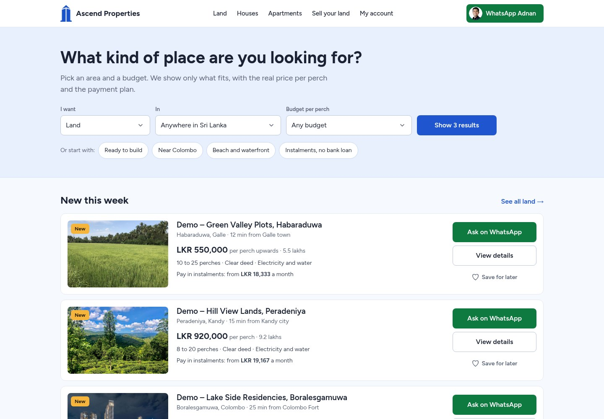</a>

The home page asks one question: *what kind of place are you looking for?* Choose what you want, where, and your budget per perch, then press **Show results**. Or tap a shortcut such as **Near Colombo** or **Instalments, no bank loan**.

Under the search, **New this week** lists the newest listings. Each one is a card with a photo, the place, the price and a monthly instalment.

#### 2. Find land

<a href="docs/images/land.jpg">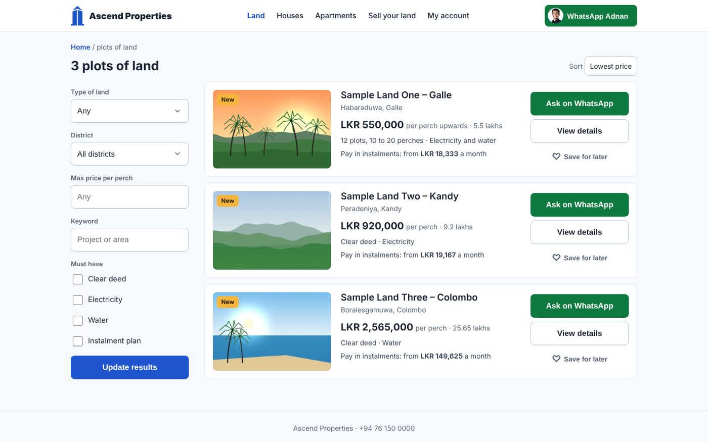</a>

The results show the price per perch, the same price in lakhs, and the monthly instalment, so a buyer can compare plots without a calculator. The filters are the things people really ask about: a clear deed, electricity, water and an instalment plan. Results can be sorted by lowest price.

#### 3. Open a listing

<a href="docs/images/listing.jpg">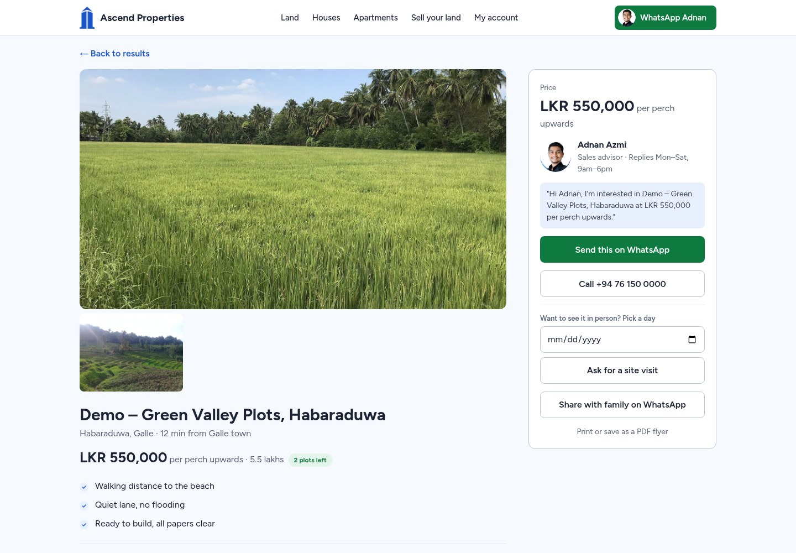</a>

A listing has its photos, the price, short highlights, and the plot size and papers. On the right, the advisor card has the advisor's name and reply hours, and a message that is already written for you.

<a href="docs/images/listing-lake.jpg">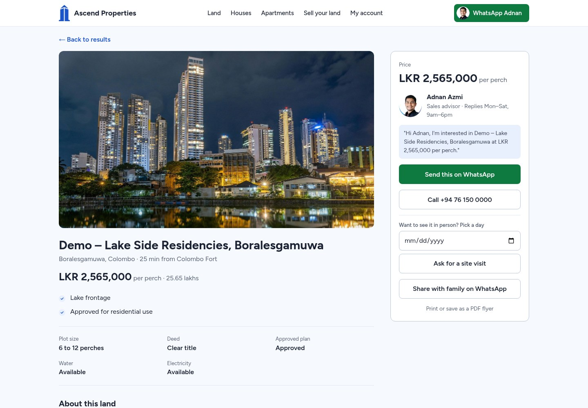</a>

Every listing has its own photos and details. This one is by a lake near Colombo.

#### 4. Plots and prices

<a href="docs/images/listing-plots.jpg">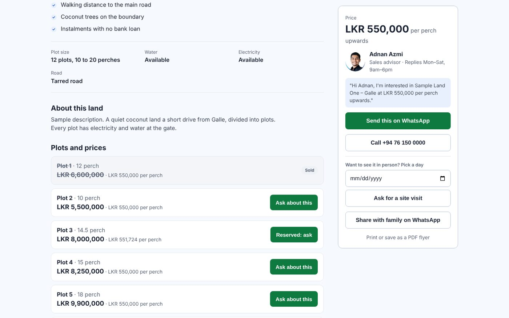</a>

A listing can have a table of numbered plots. Each has its size, its price and a status: available, reserved or sold. A sold plot is crossed out, a reserved one says **Reserved: ask**, and an available one has **Ask about this**.

#### 5. Ask, visit or share

The advisor card has four things a buyer can do:

* **Send this on WhatsApp** opens WhatsApp with a message that already names the listing and its price.
* **Call** dials the agency.
* **Pick a day** and **Ask for a site visit** opens WhatsApp with a message asking to visit on that day.
* **Share with family on WhatsApp** sends the listing to someone else. **Print or save as a PDF flyer** gives a one-page flyer.

#### 6. On a phone

<p align="center">
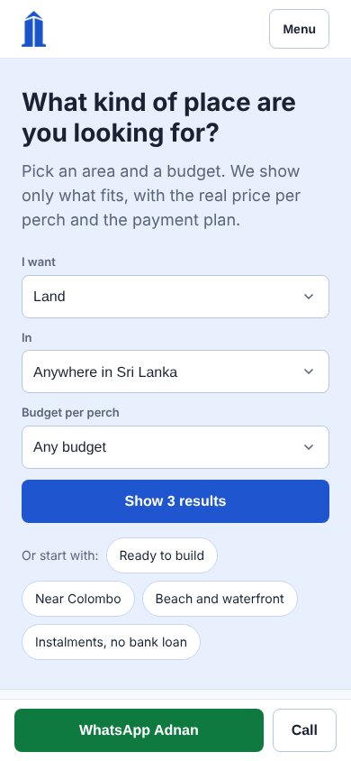
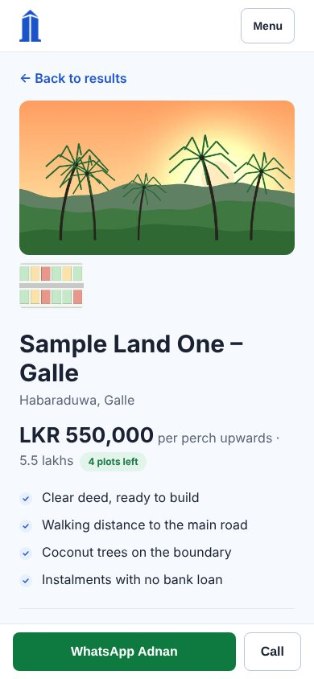
</p>

On a phone the menu folds into one button, the filters fold away, and a **WhatsApp** and **Call** bar stays at the bottom of every listing, so the next step is always one tap away.

#### 7. Houses

<a href="docs/images/houses.jpg">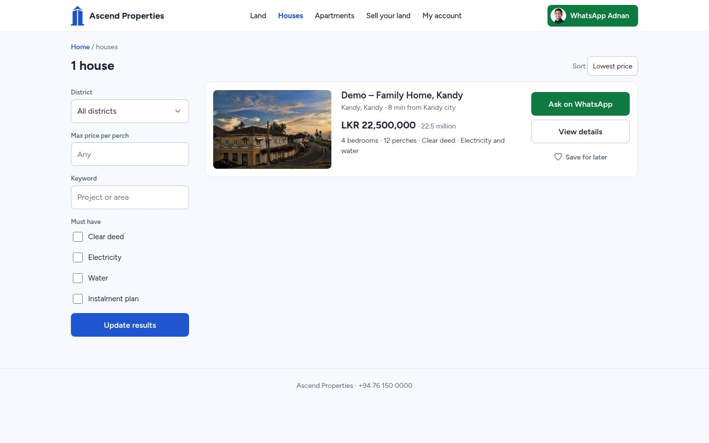</a>

Houses and apartments work the same way. A house card shows the bedrooms and the plot size, and the total price, here **LKR 22,500,000**, with the same buttons.

#### 8. Sell your land

<a href="docs/images/sell.jpg">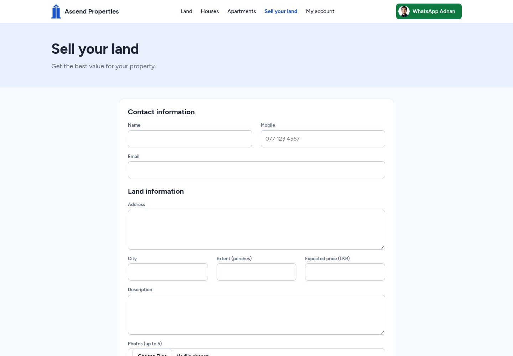</a>

Owners can send their land to the agency. They give their name, mobile and email, then the address, town, size in perches, expected price and a description, and add up to five photos. The staff see it under **Sellers** (step 14).

That is the buyer's whole journey. Now the people behind the screen.

### Part 2: The staff

The staff have no code to touch. They sign in at `/login` and see their own pages.

#### 9. Today

<a href="docs/images/admin-dashboard.jpg">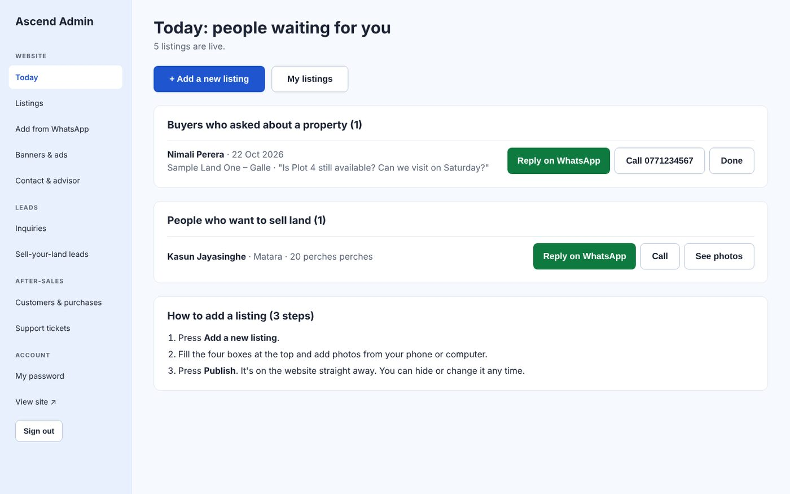</a>

The admin opens on **Today**: who has asked about a property, and who wants to sell. Each one has **Reply on WhatsApp** and **Call** buttons, and **Done** when it has been dealt with. It uses plain words on purpose.

#### 10. Listings

<a href="docs/images/admin-listings.jpg"></a>

All the listings in one table, with the type, the district, the price and whether each is on the website. **+ Add a new listing** starts a new one.

#### 11. Edit a listing

<a href="docs/images/admin-listing-edit.jpg">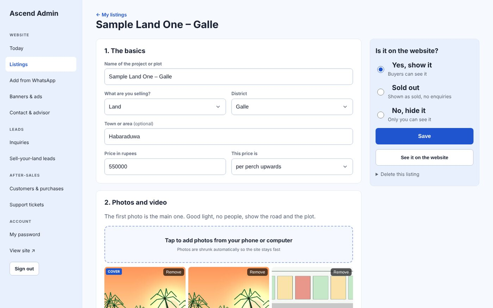</a>

Adding a listing takes a few boxes and some photos. Choose photos from the phone: they are made smaller before they are uploaded. The first photo is the main one.

"Is it on the website?" is a simple choice between **Yes, show it**, **Sold out** and **No, hide it**. On the same page staff can add plots and prices, highlights, nearby places with times, a map link, a video link, a brochure and the payment plan.

#### 12. Add from WhatsApp

<a href="docs/images/admin-import.jpg"></a>

This is the time-saver. Paste one posted message, or choose a whole exported WhatsApp chat (the `.zip` with media). Each listing it finds becomes a **hidden draft** with the district, size, price and papers filled in, and its photos. Staff check it, fix what is wrong and publish it. Nothing goes live until they say so.

#### 13. Inquiries

<a href="docs/images/admin-inquiries.jpg"></a>

Questions from listing pages arrive here. Reply on WhatsApp, call or email, and set the status to new, contacted or closed. **Download as Excel (CSV)** saves them all.

#### 14. Sellers

<a href="docs/images/admin-sellers.jpg"></a>

The owners who filled in the form in step 8 appear here, with their photos, which only admins can see. They are marked contacted or closed in the same way.

#### 15. Banners and ads

<a href="docs/images/admin-banners.jpg"></a>

A message on the home page hero, a banner under it, or a sponsored slot between listings. Each has a headline, a link, an optional picture or video, and start and end dates. **Pause** hides one without deleting it.

#### 16. Contact and advisor

<a href="docs/images/admin-settings.jpg"></a>

The WhatsApp number every button uses, the phone number, the advisor's name, title, reply hours and photo, the office address and the social pages. A change shows on every page at once.

The staff's work is finished once a buyer says yes. Then the third person in the story arrives.

### Part 3: The customer

After a sale the customer gets a login, and the agency keeps the records.

#### 17. Customers and purchases

<a href="docs/images/admin-customers.jpg"></a>

Customers do not register themselves. Staff add a customer with a name, phone, email (their login) and a temporary password of at least 8 characters. Then they add the purchase: the project, the plot and the total price.

#### 18. One customer

<a href="docs/images/admin-customer.jpg"></a>

For each customer, staff record payments with a date, a description, the amount and a receipt, upload documents such as the agreement and the deed, set the **handover stage** and the next instalment date, and reset a forgotten password.

#### 19. The customer portal

<a href="docs/images/portal.jpg">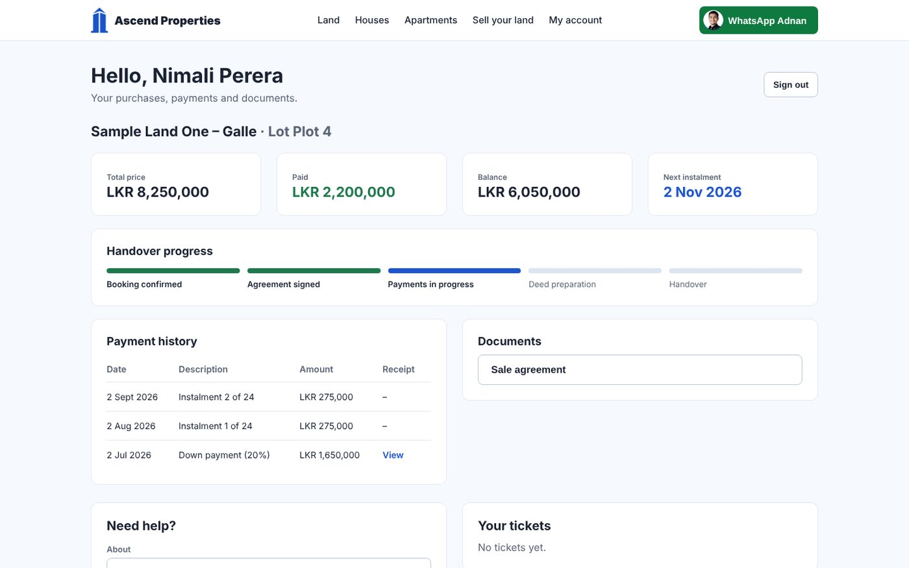</a>

The customer signs in and is taken to `/portal`. They see only their own purchases: the total, what they have paid, the balance, the next instalment, the five handover stages (Booking confirmed, Agreement signed, Payments in progress, Deed preparation and Handover), every payment with its receipt, and their documents. See [Customer portal](docs/Customer%20portal.md).

#### 20. Support tickets

<a href="docs/images/admin-tickets.jpg"></a>

If something is wrong, the customer opens a ticket from their portal. Staff read it, reply, and close it when it is solved. The customer sees the replies in the portal.

That closes the loop: the staff's listings are what the buyer searched for in step 2. More in the [Admin guide](docs/Admin%20guide.md).

## Run it yourself

You need Node 22.22 or newer (Astro 7 requires it). There is nothing to set up in the cloud: Wrangler runs a local copy of D1 and R2 for you.

```bash
git clone https://github.com/Hikki-dev/ascendproperties-lk.git
cd ascendproperties-lk
npm install
cp .dev.vars.example .dev.vars     # set ADMIN_EMAIL and ADMIN_PASSWORD
npm run db:local                   # creates the local database and five sample listings
npm run dev                        # http://localhost:4321
```

Sign in at `/login` with the admin email and password from `.dev.vars`. The first admin is created the first time you sign in.

**Want it to look like the pictures above?** With `npm run dev` still running, in a second terminal:

```bash
bash demo/load.sh
```

That adds the sample photos, plots, highlights and nearby places, some enquiries and leads, and a customer with a purchase, three payments and a document. Sign in at `/portal` as `nimali@example.com` with the password `demo-customer-1`. Details are in [Demo data](docs/Demo%20data.md). It only touches your local copy.

`npm test` runs the unit tests (11 of them). `tests/smoke.sh` runs a longer end-to-end check against the dev server. Step by step, with fixes for the usual snags, is in [Getting started](docs/Getting%20started.md).

## Put it online

```bash
npx wrangler login
npx wrangler d1 create ascend-db          # paste the database_id into wrangler.jsonc
npx wrangler r2 bucket create ascend-media
npm run db:remote                         # apply migrations
npx wrangler secret put ADMIN_EMAIL
npx wrangler secret put ADMIN_PASSWORD
npm run deploy
```

Then in the Cloudflare dashboard add your domain, turn on **Bot Fight Mode** and a rate-limit rule for `/api/*` and `/login`, and, if you like, put `/admin*` behind **Cloudflare Access** (free for up to 50 users) for a second login. Spam protection with Turnstile is optional. All the steps, including the optional ones, are in [Deploying](docs/Deploying.md).

## Your privacy and safety

* Passwords are hashed with PBKDF2-SHA256 (100,000 rounds, a salt for every user). A session is a random 256-bit token in an `HttpOnly`, `SameSite=Lax` cookie, kept in D1, and it expires after 14 days.
* `/admin/*` needs an admin session and `/portal/*` needs a login. Forms from other websites are refused (Astro's origin check).
* Every SQL query is parameterised. Uploads are checked for type and size. Redirects, map links and video links are checked against exact hostnames.
* Receipts and customer documents are private. They are served only to their owner or an admin. Seller photos are for admins only.
* Public forms have a hidden honeypot field, and Cloudflare Turnstile turns on by itself once its secret exists.
* Security headers are set on every response.

To report a security problem, read [SECURITY.md](SECURITY.md).

## Help and more reading

| If you want to | Read |
|---|---|
| Run it step by step | [Getting started](docs/Getting%20started.md) |
| Use the admin | [Admin guide](docs/Admin%20guide.md) |
| See what customers see | [Customer portal](docs/Customer%20portal.md) |
| Understand how it is built | [How it works](docs/How%20it%20works.md) |
| Put it on Cloudflare | [Deploying](docs/Deploying.md) |
| Fill a local copy with sample data | [Demo data](docs/Demo%20data.md) |
| See who took the sample photos | [Photo credits](docs/Photo%20credits.md) |
| Fix a problem | [Fixing problems](docs/Fixing%20problems.md) |
| Find a quick answer | [Questions and answers](docs/FAQ.md) |
| See why it works like primelands.lk | [Research](docs/PRIMELANDS-RESEARCH.md) |
| Change the code | [Contributing](CONTRIBUTING.md) |
| See what changed | [Changes](CHANGELOG.md) |

### Where things live

```
migrations/      D1 schema            seed.sql   five sample listings (delete before launch)
src/lib/         db, auth, util, parse, chat      src/pages/   public site, /admin, /portal, /api
src/components/  ImageUploader, LoanCalc, LotsEditor, ChatImport (React islands), cards, ads
demo/            sample data, sample photos and the script that loads them
tests/           unit tests and an end-to-end smoke script
```

## Legal and responsibility

* Ascend Properties is a portfolio and learning project, not a real agency's site. The listings in the demo are samples.
* The code is released under the [MIT licence](LICENSE), as it is, with no promises. The sample photos keep their own licences, see [Photo credits](docs/Photo%20credits.md).
* [primelands.lk](docs/PRIMELANDS-RESEARCH.md) is studied only for how a site like this works. This project is not connected to it.
* Built with [Astro](https://astro.build), [React](https://react.dev) and [Cloudflare Workers](https://workers.cloudflare.com). Zip handling is by [fflate](https://github.com/101arrowz/fflate).
* Built by [Yusuf (Hikki-dev)](https://github.com/Hikki-dev).
